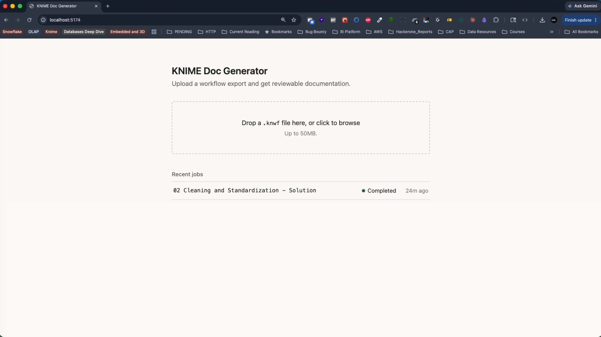
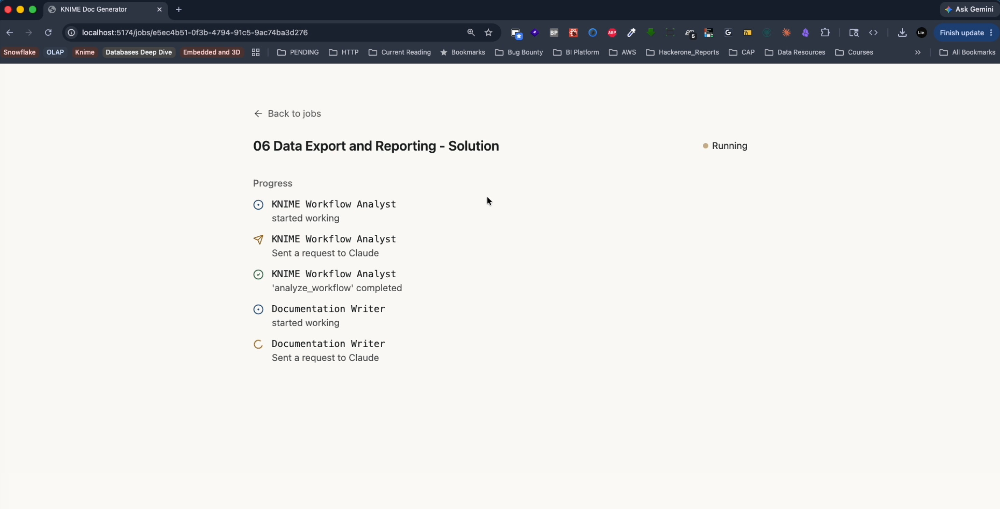
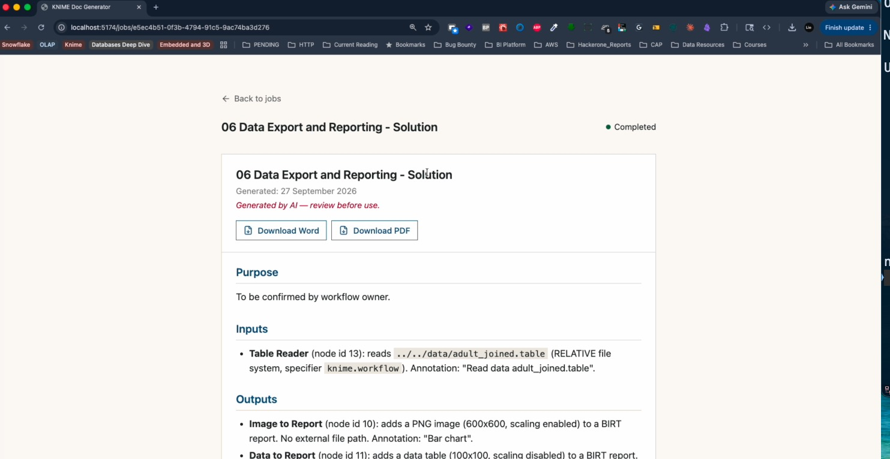
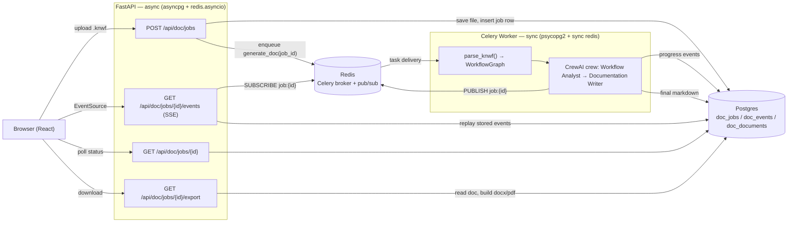

# KNIME Doc Generator

Upload a KNIME `.knwf` workflow export and get back reviewable documentation like Purpose, Inputs, Outputs, Transformation Steps, and Notes as a Word (`.docx`) or PDF document.

A two-agent [CrewAI](https://github.com/crewAIInc/crewAI) crew (backed by Claude) reads parsed workflow and writes the doc; you watch it work in real time over Server-Sent Events, then download the result.

Node names, connections, and configuration values come straight from the workflow's own XML, crew is instructed to state only what's actually in the file, and to say "To be confirmed by workflow owner" rather than invent a business purpose the workflow doesn't state.

## What it does

1. You drop a `.knwf` file onto the web UI.
2. The file is parsed into a compact JSON graph (nodes, connections, settings and secrets redacted, UI noise stripped).
3. A Celery worker runs a two-agent crew against that graph: a **Workflow Analyst** produces a structured analysis, then a **Documentation Writer** turns it into the five-section doc.
4. Progress streams live to the browser (which agent is working, what it just finished).
5. Once done, the doc renders in-browser, and Word/PDF downloads are one click away.

## App Screenshots







> [!IMPORTANT]
> Watch video in the demo folder for a real upload and live progress stream, including the final doc download.

## Architecture



API and worker deliberately don't share a database session or an event loop, see [CLAUDE.md](./CLAUDE.md) ("Sync vs. async DB access") for why `crew.kickoff()` being a blocking call makes that the right call, not an oversight.

## Quick start

Requires Docker and Docker Compose.

```bash
cp .env.example .env
# Edit .env and set ANTHROPIC_API_KEY — everything else has a working default
docker compose up --build
```

Then open **http://localhost:5174**. Try it with the two sample workflows in `samples/`.

| Service    | URL                              |
|------------|----------------------------------|
| Frontend   | http://localhost:5174            |
| API        | http://localhost:8010            |
| API docs   | http://localhost:8010/docs       |
| Health     | http://localhost:8010/api/v1/health |
| Postgres   | localhost:5434                   |
| Redis      | localhost:6380                   |

## Environment variables

All of these live in `.env` (copy `.env.example` to start) and are read by `backend/app/core/config.py`.

| Variable | Default | Purpose |
|---|---|---|
| `POSTGRES_USER` / `POSTGRES_PASSWORD` / `POSTGRES_DB` | `knime` / `knime_dev` / `knime_sop` | Postgres credentials, used by both the `postgres` container and `DATABASE_URL` |
| `DATABASE_URL` | `postgresql+asyncpg://...` | Async DB URL the API uses; the worker derives a sync (`psycopg2`) variant from this automatically |
| `REDIS_URL` | `redis://redis:6379/0` | Used for the pub/sub channel that carries live progress events |
| `CELERY_BROKER_URL` / `CELERY_RESULT_BACKEND` | Redis DB 0 / DB 1 | Celery's task queue and result store |
| `ANTHROPIC_API_KEY` | *(required)* | Claude API key for the crew. Missing this fails a job immediately with a clear error instead of hanging on the first LLM call |
| `LLM_MODEL` | `anthropic/claude-sonnet-5` | Passed to CrewAI's LiteLLM-backed `LLM`, so it follows LiteLLM's `provider/model-id` format |
| `UPLOAD_DIR` | `/tmp/knime_uploads` | Shared volume path where uploaded `.knwf` files land, read by both `api` and `worker` |
| `MAX_UPLOAD_MB` | `50` | Upload size limit, enforced while streaming (an oversized file is rejected without buffering the whole thing in memory) |

## Running tests

```bash
docker compose exec api pytest -q
```

Tests run against the real Postgres/Redis from `docker-compose.yml` (not mocks or sqlite), see `backend/tests/conftest.py`. They cover the KNIME parser, upload validation, job/export endpoints, the size guard, and the failure paths below (missing API key, broker unavailable, Redis dropping mid-stream). They truncate the `doc_*` tables before every test, so re-run a real upload afterward if you want a job to look at in the UI.

Frontend type-checking:

```bash
docker compose exec frontend npx tsc --noEmit
```

## Failure handling

A few failure modes were deliberately hardened rather than left to surface as a hang or an unhandled 500, see the "Failure Handling Hardening" note in CLAUDE.md for the live tests (including a real one that caught a ~20s DNS-retry hang a plain `try/except` didn't actually fix) that led to each of these:

- **Corrupt / non-KNIME `.knwf`** - fails fast with the real parse error (e.g. `BadZipFile: File is not a zip file`) as `job.error`.
- **A failed crew run** (bad LLM response, rate limit, invalid key, etc.) — caught generically, with the error message redacted of anything key-shaped and capped in length before it's ever logged or stored.
- **Redis unreachable** - enqueueing a job is bounded to 5 seconds (run off the request thread, so one stuck request can't freeze the whole API for everyone else); the live SSE stream emits a real `error` event instead of just going silent.

## Out of scope for this MVP → Next steps

These were deliberately left out to keep the MVP scoped (see CLAUDE.md "Goal & Scope"). Roughly in the order they'd likely matter to a real rollout:

1. **External connector integrations** (KNIME Hub, GitHub, etc.) - pulling workflows directly from a KNIME Hub space instead of a manual `.knwf` export/upload.
2. **Team / space / hierarchy management** - right now every job is global with no ownership or access control.
3. **Approval workflows / sign-off chains** - a generated doc has no review/approve state; it's download-and-use.
4. **Workflow versioning or diff views** —-re-running the same workflow produces an unrelated new job, not a new version of the same doc.
5. **Bulk / batch processing** - one `.knwf` file per job; no folder-of-workflows mode.
6. **Admin-editable doc templates** - the five-section template (Purpose/Inputs/Outputs/Transformation Steps/Notes) is fixed in `backend/app/crew/config/tasks.yaml`, not configurable per team/workflow type.
7. **Bring-your-own-model UI** —`LLM_MODEL`/`ANTHROPIC_API_KEY` are operator-set env vars, not something an end user picks per job.